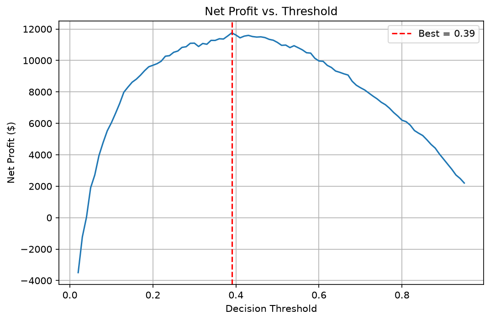

# Customer Churn Prediction Dashboard

An end-to-end churn analysis project: data cleaning, SQL analysis, an XGBoost prediction model, and an interactive Streamlit dashboard with SHAP explanations and AI-generated retention suggestions (Gemini).

**Dataset:** Telco Customer Churn (7,043 customers, 26.5% churn rate)

## Features
- **Overview tab:** KPIs (customers, churn rate, monthly revenue lost), churn rate by contract type, sidebar filters, and a business-impact slider showing revenue saved.
- **Predict churn tab:** enter a customer's details (or load a High-Risk / Low-Risk preset), get a churn probability, a SHAP chart explaining the prediction, and a retention suggestion from Gemini.
- **Ask your data tab:** ask a question in plain English; Gemini writes a pandas expression and the app runs it.

## Model Performance
Tuned XGBoost classifier, decision threshold 0.3.

| Metric | Value |
|---|---|
| ROC-AUC | 0.846 |
| Recall (churn class, threshold 0.3) | 0.77 |

## Cost-Benefit Threshold Selection
The threshold was checked using money instead of F1 score. Thresholds from 0.02 to 0.95 were scored on cross-validated predictions from the training set only; the test set was used once for a final check.

Assumptions: $65 monthly revenue per customer, $15 retention offer, 60% of flagged churners retained.

Result: net profit peaks near a threshold of 0.39 and stays close to its maximum between 0.3 and 0.5, so the chosen 0.3 is a reasonable operating point.



## Tech Stack
Python, pandas, SQL (SQLite), scikit-learn, XGBoost, SHAP, Streamlit, Google Gemini API

## Project Structure
```
churn project/
├── app/             # Streamlit dashboard (app.py)
├── data/            # raw and cleaned data, churn.db
├── models/          # trained model and feature columns
├── notebooks/       # 01_cleaning, 02_sql_analysis, 03_model_training
├── screenshot/      # dashboard screenshots and plots
└── sql/             # SQL queries
```

## How to Run
```bash
pip install -r requirements.txt
export GEMINI_API_KEY="your_key"      # Windows PowerShell: $env:GEMINI_API_KEY="your_key"
streamlit run app/app.py
```

## Limitations and Future Work
- Probabilities from XGBoost are not calibrated; calibration (e.g. isotonic regression) would make risk scores more realistic.
- Customer behaviour changes over time, so the model should be retrained periodically and monitored for data drift.
- The retention-success rate (60%) in the cost-benefit analysis is an assumption and should be replaced with real campaign data.
